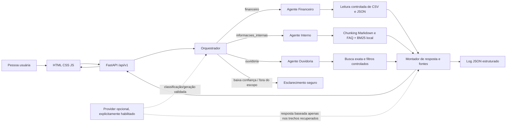

# Arquitetura

## Diagrama

## Fluxo de uma pergunta

1. Validar corpo, tamanho e campos via Pydantic; gerar `execution_id` UUID e marcar o instante de início.
2. O orquestrador classifica em `financeiro`, `informacoes_internas`, `ouvidoria` ou `fora_do_escopo`, com confiança e justificativa curta. Regras locais são fallback obrigatório; provider externo só é chamado se estiver configurado e explicitamente habilitado.
3. A confiança abaixo de `CLASSIFICATION_CONFIDENCE_THRESHOLD`, uma ambiguidade ou pergunta fora do escopo encerra com solicitação de esclarecimento segura.
4. O agente especializado consulta somente o domínio classificado. Financeiro usa agregações determinísticas com `Decimal`; Interno usa recuperação BM25 sobre chunks; Ouvidoria usa protocolo exato e filtros permitidos.
5. A resposta inclui trechos/campos de evidência como fontes, localização e excerpt. O provider, quando usado, recebe apenas pergunta e evidência selecionada, nunca autoridade para executar código ou consultar outro domínio.
6. A resposta Pydantic inclui categoria, confiança, agente, fontes, execution ID, tempo e timestamp. Um log JSON registra metadados de rastreio sem o texto integral da pergunta.

## Componentes

- `app/api/routes`: health, agentes, chat e reindex.
- `app/core`: configuração, logging e exceções seguras.
- `app/models`: schemas de entrada/saída e tipos de domínio.
- `app/agents`: orquestrador e especialistas.
- `app/knowledge`: loaders, chunking, indexação e recuperação lexical.
- `app/llm`: interface de provider, implementação externa opcional e fake para testes.
- `app/services`: operações tabulares determinísticas e montagem de resposta.
- `frontend/`: frontend servido pela mesma origem.
- `data/processed`: índice local reconstruível; `logs/`: registros runtime ignorados pelo Git.

## Estratégia de conhecimento

Os dados recebidos são pequenos e locais. CSV/JSON financeiros e CSV/JSON de Ouvidoria são consultados por funções delimitadas, sem SQL arbitrário ou retrieval textual em valores agregados. Os dez Markdown e o FAQ JSON interno são preservados em seus diretórios. O loader cria chunks por seção com sobreposição configurável e metadados de domínio, caminho relativo permitido, seção, versão e ID estável. O índice JSON gerado fica em `data/processed/knowledge_index.json`, pode ser apagado e reconstruído por `python -m scripts.ingest` ou endpoint de desenvolvimento. Toda recuperação recebe um filtro obrigatório de domínio. Nenhum trecho é interpretado como instrução do sistema.

## Classificação

O modo fallback usa regras de intenção explícitas e pesos por grupos de termos/expressões, incluindo conflitos e cobertura mínima. A pontuação é um escore heurístico de confiança, validado como número entre 0 e 1; não será descrita como probabilidade calibrada. Quando um provider estiver habilitado, a saída estruturada será validada por Pydantic e aceita apenas para categorias permitidas; falhas/timeouts caem para o classificador local.

## Fluxo de erros

- Entrada inválida: HTTP 422 do Pydantic.
- Classificação sem confiança ou ausência de evidência: resposta explicando a limitação e pedindo detalhe; sem inventar fatos.
- Timeout/erro/provider inválido: fallback local; se não houver evidência recuperável, mensagem controlada.
- Erro interno: log com classe do erro e execution ID; cliente recebe mensagem genérica, sem stack trace.
- Reindex: falhas não substituem índice válido; publicação do novo índice é atômica.

## Dependências e fronteiras

FastAPI, Pydantic e Uvicorn atendem à API. pytest, HTTPX e Ruff apoiam desenvolvimento. Recuperação inicial não exige banco, internet, embeddings ou API paga. Um provider externo é opcional, com timeout e tentativas limitadas; nenhum segredo é embutido no código. CORS fica restritivo por padrão e o frontend usa mesma origem.

## Segurança e operação

O serviço local não inclui autenticação; não publicar na internet sem controles de acesso. Não registrar o texto da pergunta. Restringir os caminhos de fontes à raiz de conhecimento e servir bases como read-only no container. O endpoint de reindex deve ficar desativado em produção por padrão. Dados originais permanecem imutáveis.
